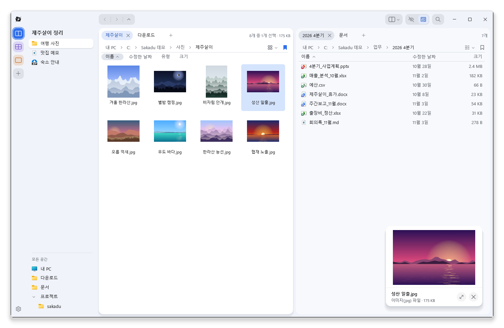
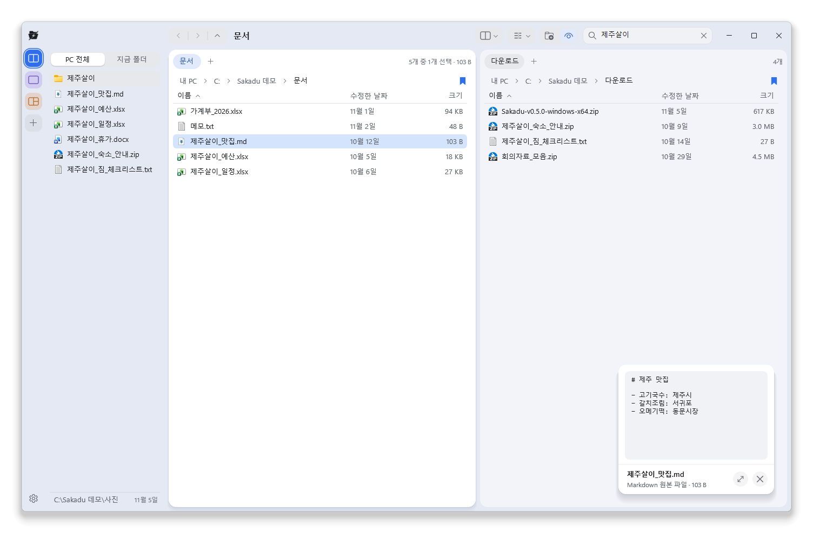
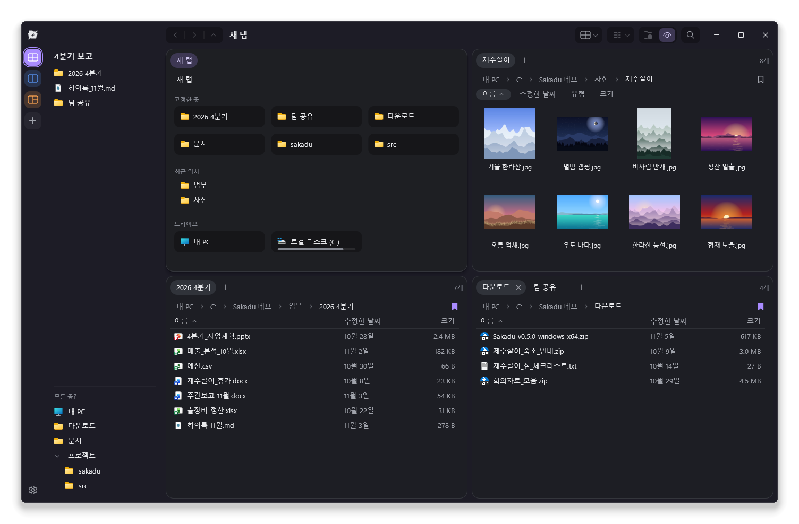

[한국어](README.md) | **English**

# Sakadu

A Windows file manager that keeps several folders open side by side and finds any file on your disk as you type its name.



**[Download the latest release](https://github.com/noddish/sakadu/releases/latest)** · Windows 11 · a single exe, no installer · free and open source

> The interface is Korean only for now.

## Features

- **Instant search**: press Ctrl+F, type a few letters, and results from the whole disk show up right away (10–20 ms over 1.8 million entries). Results stay in the left panel so you can open them one by one. Add a shared folder or USB drive and it's searched too.
- **Several folders in one window**: split into 2, 3 or 4 panes, each with its own tabs and its own view (details, list or icons). Drag a tab to move it to another pane, or drag the point where the dividers meet to resize both ways at once.
- **Ctrl+K command menu**: jump to an open tab, pinned place or recent location, or find and run a command by name (Korean initial consonants work too).
- **Works like Explorer**: right-click menus, the copy progress dialog and drag and drop behave as they do in Explorer. Moved something by mistake? Use the **되돌리기** (undo) button on the notice, or Ctrl+Z.
- **Look before you open**: select a file and a preview card appears at the bottom of the neighbouring pane: pictures and text, and also the first page of PDFs and PowerPoint files, a frame of a video, Hangul (hwp) documents, SVG, Photoshop (psd) and Illustrator (ai) files. GIFs move, and HTML files show the rendered page, drawn by the Edge on your PC (HTML downloaded from the internet shows its code). Excel and Word files open in the preview pane (Alt+P), where you can pin a reference file to keep it in view.
- **Archives open like folders**: double-click a zip, 7z or tar file to browse inside it. Open files straight from it or drag them out; the inside is read-only.
- **Workspaces**: switch workspaces from the rail on the left. Each one remembers its own layout (panes and tabs), pinned places and color. Drag pinned places and the favorites under '모든 공간' (all spaces) to reorder them, put them into groups or move them between the two. A new tab opens on your pinned places and recent locations.
- **NAS**: shares that need a sign-in open through the Windows sign-in dialog, and a dropped connection shows the last list you saw.
- **Light**: no runtime or web view; it's Rust drawing with Direct2D. Dark mode follows your Windows setting.





## Getting started

1. Grab `Sakadu-<version>-windows-x64.zip` from [Releases](https://github.com/noddish/sakadu/releases/latest) and unzip it.
2. Run `sakadu.exe`. If Windows shows "Windows protected your PC", click **More info → Run anyway** (the exe isn't code-signed yet).
3. For whole-disk search, open search (Ctrl+F), press **검색 서비스 설치** (install search service) once and approve the admin prompt.

In Settings (the gear at the bottom left) you can use Sakadu as the default file manager, keep it in the tray so the search hotkey works after closing the window, and change the theme and shortcuts. Press F1 for usage tips.

## Keys you'll use most

| Key | What it does |
|---|---|
| Ctrl+F | Search the whole disk |
| Ctrl+K | Command menu |
| Just start typing | Filter the current folder (Esc clears) |
| Ctrl+1 – Ctrl+5 | Change the pane layout |
| Tab / Shift+Tab | Next / previous pane |
| Ctrl+T / Ctrl+W | New tab / close tab |
| Alt+P | Preview pane |
| Ctrl+B / Ctrl+D | Go to the sidebar list / pin to this workspace |
| Ctrl+Z | Undo the last file operation |

All other shortcuts are listed (and can be changed) in Settings → **단축키** (Shortcuts).

## Good to know

<details>
<summary>Search service and privacy</summary>

- It reads **only file and folder names** from the NTFS file table and keeps them in memory (about 120 MB for 1.8 million entries). File contents are never read and the index isn't saved to disk.
- There is no network code, so nothing leaves your PC. The app and the service (SakaduIndex) talk only over a local pipe.
- Results only include what the searching Windows account can open in Explorer. How this was checked: [docs/search-permissions-check.md](docs/search-permissions-check.md)
- Query syntax: spaces mean all words, a trailing `\` searches paths, `|` means any of them (`견적 2026 | 계약서`).
- The service is copied to `C:\Program Files\Sakadu`. Updating the app doesn't update the service until you reinstall it.

</details>

<details>
<summary>Default file manager and tray</summary>

- Turn them on in Settings → 일반 (General). Only current-user settings (HKCU) change, and turning them off restores the previous values.
- The exe is copied to `%LOCALAPPDATA%\Programs\Sakadu`. Running a newly downloaded `sakadu.exe` takes over from the running window and updates that copy.
- To quit completely from the tray, right-click the tray icon and choose **끝내기** (quit).

</details>

<details>
<summary>Uninstalling</summary>

1. In Settings, turn off **기본 파일 관리자로 사용** and **트레이에서 대기**, and **remove** the search service.
2. Delete the unzipped folder, `%APPDATA%\Sakadu` (settings and favorites) and `%LOCALAPPDATA%\Programs\Sakadu` (if present).

</details>

## Found a problem?

Please open an [issue](https://github.com/noddish/sakadu/issues). Running `sakadu.exe --log` and attaching `%TEMP%\sakadu.log` helps a lot (it contains folder paths, so check it before posting).

## Building

You need stable Rust (MSVC, edition 2024) and the Windows SDK.

```
cargo build --release
cargo test
```

<details>
<summary>Development notes</summary>

- If the linker fails with LNK1104 because the path is too long, move only the build output: `$env:CARGO_TARGET_DIR = "$env:TEMP\sakadu-target"`
- Tests that touch the shell or the service, and benchmarks: `cargo test --release -- --ignored --nocapture`
- Test switches: `SAKADU_THEME=dark|light`, `SAKADU_TRAY=0|1`, `SAKADU_ISOLATED=1` (a test window that runs next to your own Sakadu; also point `APPDATA` and `LOCALAPPDATA` elsewhere)
- Releases: bump `version` in `Cargo.toml` and push a tag like `v0.7.0`; GitHub Actions builds a draft release.
- Code: `app.rs` (layout, input, drawing) and `app/` (panels, search, preview, command menu, start page, settings), `index.rs`·`service.rs` (search index and service), `shell.rs` (shell menus, file operations), `archive.rs` (reading inside archives), `thumbs.rs`·`page.rs` (preview pictures, HTML page shots), `listing.rs` (folder reading)
- Shared code: the modules in `src/lib.rs` (pane and tab state, saved formats, name search and query rules, natural sort) build without the Windows API. To prepare a macOS version, CI checks them on macOS with `cargo test --lib`.
- Mac prototype: `src/mac/` (`cargo build --features mac-app --bin sakadu-mac`). Mac search uses its own index (`src/mac/search.rs`): once turned on, it reads the names under the home folder and the app folders into memory only, and keeps them current with the macOS change log (FSEvents).

Contributions are welcome. Please open an issue first for big changes.

</details>

## Name and license

Sakadu comes from *saccade*, the quick jump your eyes make from one point to another. [GPL-3.0-or-later](LICENSE).
