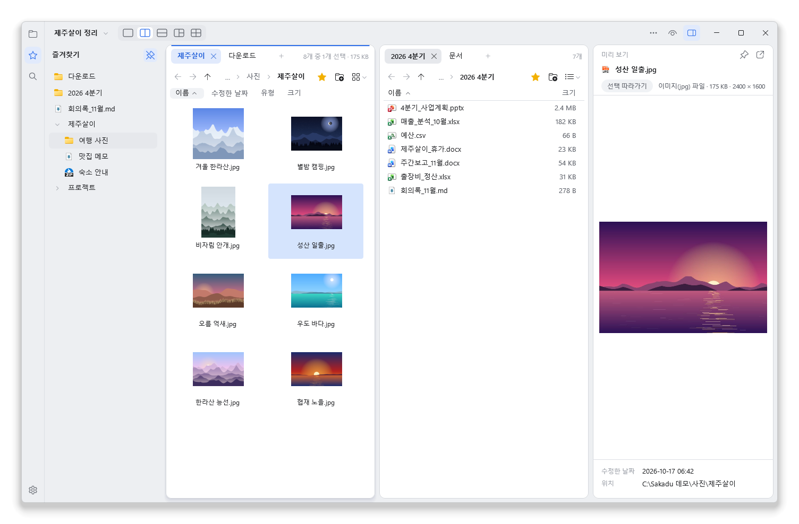
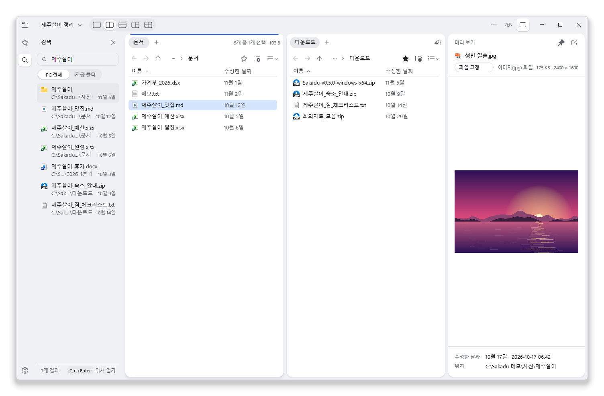
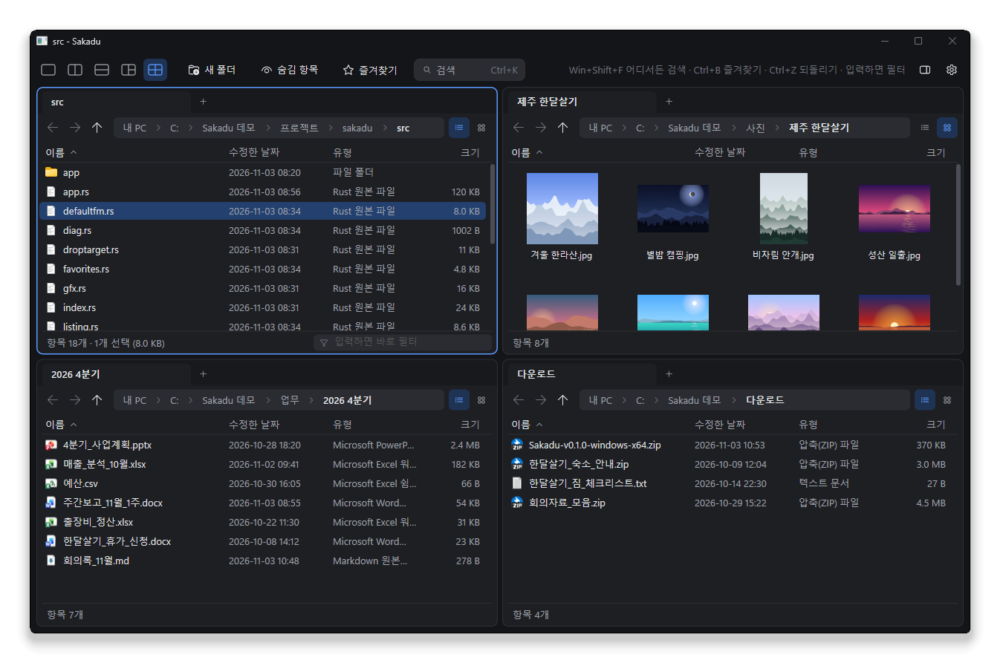

[한국어](README.md) | **English**

# Sakadu

A Windows file manager that keeps several folders open side by side and finds any file on your disk as you type its name.



**[Download the latest release](https://github.com/noddish/sakadu/releases/latest)** · Windows 11 · a single 0.7 MB exe, no installer · free and open source

> The interface is Korean only for now.

## Why you might like it

**Search without waiting.** Press Ctrl+F, type part of a name, and results from the whole disk show up right away.
On a PC with about 1.8 million files and folders, a search takes 10–20 ms.
While Sakadu is running, a global hotkey brings up search from any app. Turn on **트레이에서 대기** (stay in tray) and that works even after you close the window.
Add a shared folder or USB drive and it's searched too.
Paste a list of file names to find them all at once, then open or copy the ones you pick in one go.



**Stop juggling windows.** Split the window into 2, 3 or 4 panes, each with its own tabs. Drag a tab to move it to another pane.
Moving files from Downloads into a project folder happens on one screen.

**Works like Explorer.** Right-click menus, the copy progress dialog and drag and drop behave exactly as they do in Explorer.
Moved something by mistake? Ctrl+Z.

**Look before you open.** Thumbnail view and a preview pane show photos, PDFs and text files right next to the list.

**Light.** No runtime or web view. It's Rust drawing with Direct2D. Unzip and run the exe.

Dark mode follows your Windows setting.



## Getting started

1. Grab `Sakadu-<version>-windows-x64.zip` from [Releases](https://github.com/noddish/sakadu/releases/latest) and unzip it anywhere.
2. Run `sakadu.exe`.

- If Windows shows "Windows protected your PC" on first launch, click **More info → Run anyway**. The exe isn't code-signed yet.
- Whole-disk search needs a small background service. Press **검색 서비스 설치** (install search service) in the Ctrl+F window once and approve the admin prompt.
- To open folders in Sakadu by default, open Settings (gear) → **일반** (General) and turn on **기본 파일 관리자로 사용** (use as default file manager).
- To keep the search hotkey working after you close the window, turn on **트레이에서 대기** (stay in tray) in the same place. Sakadu then also starts at sign-in, without a window.
- Theme, accent color, font and size live in Settings → **화면** (Appearance); shortcuts in Settings → **단축키** (Shortcuts). Press F1 for usage tips.
- Built and tested on Windows 11. It's meant to run on Windows 10 (64-bit) too, but that hasn't been tested yet.

## Keys you'll use most

| Key | What it does |
|---|---|
| Ctrl+F | Search the whole disk |
| Just start typing | Filter the current folder (Esc clears) |
| Ctrl+1 – Ctrl+5 | Change the pane layout |
| Tab / Shift+Tab | Next / previous pane |
| Ctrl+T / Ctrl+W | New tab / close tab |
| Alt+P | Preview pane |
| Ctrl+B / Ctrl+D | Open favorites / add to favorites |
| Ctrl+Z | Undo the last file operation |

<details>
<summary>All shortcuts</summary>

| Key | What it does |
|---|---|
| Typing | Filter the current pane (Esc clears) |
| Enter / Ctrl+Enter | Open / open folder in a new tab |
| Backspace, Alt+↑ | Parent folder |
| Alt+← / Alt+→, mouse back/forward buttons | Back / forward |
| Tab / Shift+Tab | Switch pane |
| Ctrl+T / Ctrl+W / Ctrl+Tab | New tab / close tab / next tab |
| Drag a tab | Reorder, or move to another pane |
| Drag from empty space or the date column | Select with a rectangle (hold Ctrl to add to the selection) |
| Ctrl+1 – Ctrl+5 | Pane layout |
| Ctrl+Shift+2 / Ctrl+Shift+6 | Thumbnail view / details view |
| Alt+P | Preview pane |
| F2 / F5 | Rename / refresh |
| F4, Ctrl+L, Alt+D | Edit the path |
| Ctrl+C / Ctrl+X / Ctrl+V | Copy / cut / paste |
| Delete / Shift+Delete | Recycle Bin / delete permanently (asks first) |
| Ctrl+Shift+N | New folder |
| Ctrl+H | Show hidden items |
| Ctrl+F | Whole-disk search |
| Ctrl+Z | Undo the last file operation |
| Ctrl+B | Favorites (while open: ↑↓, Enter, F2, Del, Ctrl+↑↓, ←→ collapse/expand groups, type to jump) |
| Ctrl+D | Add to favorites (the selected folder or file, or the current folder) |
| Alt+Enter | Properties |
| Menu key, Shift+F10 | Context menu |

</details>

## Good to know

<details>
<summary>What the search service reads</summary>

- It reads **only file and folder names** from the NTFS file table (MFT) and keeps them in memory. File contents are never read. Changes come in live through the USN journal.
- Nothing is written to disk, and neither the app nor the service has any network code, so nothing leaves your PC.
- Reading the MFT needs admin rights, so it runs as a Windows service (SakaduIndex). The app talks to it over a local named pipe that refuses remote clients.
- The index takes about 120 MB of memory for 1.8 million entries.
- Results only include what the searching Windows account can see: every folder from the drive root down to the file's folder must be listable by that account (what you could browse in Explorer). Hidden files are left out of both the results and the total count. See [docs/search-permissions-check.md](docs/search-permissions-check.md) for a two-account check (Korean).
- Query syntax: space-separated words must all match. A word ending in `\`, like `work\`, matches the path. `|` means "or" (`quote 2026 | contract`). Pasting several lines joins them with `|`.
- Results: Enter opens, Ctrl+Enter opens the containing folder in a new tab. Pick several with Ctrl+click, Shift+click or Shift+↑↓, then Enter opens them all and Ctrl+C copies the files. The right-click menu also has copy path and pick all.
- The search window stays open while you visit other apps. Reopen it after closing and your last query is still there, selected: type to replace it, or press End to keep going.
- The global hotkey is the first free one of Ctrl+Alt+Space, Win+Shift+F and Ctrl+Alt+F. The toolbar shows which one you got.
- The service exe is copied to `C:\Program Files\Sakadu`. After updating Sakadu, reinstall the service to update it too.

</details>

<details>
<summary>Searching shared folders and USB drives</summary>

The search service only reads this PC's own (NTFS) disks. Shared folders (`\\server\share`), NAS and USB drives are searched once you add them.

- Open the folder in any pane and search with Ctrl+F. If nothing turns up, click **이 폴더도 검색하기** (search this folder too) in the search window.
- Settings → **검색** (Search) → **검색에 넣은 폴더** (added folders) lists them, lets you remove one, and adds folders you have open.
- The app walks the folder once with your own account and keeps the names in memory. Nothing is written to disk, so it walks the folder again each time the app starts.
- Changes come in through folder change notifications. In case a server doesn't send them, the folder is walked again every few hours, and opening it in Sakadu also brings it up to date.
- If the connection drops, the last results stay searchable and Sakadu tries to reconnect every 5 minutes.
- The app has to be running to keep up, so this pairs well with **트레이에서 대기** (stay in tray).

</details>

<details>
<summary>Using it as the default file manager</summary>

When turned on in Settings → General, opening folders and drives, and Win+E, go to Sakadu.

- Only your user settings (HKCU) change. The original values are backed up and restored when you turn it off.
- Explorer caches the old Win+E command, so Win+E may only switch after you sign out and back in or restart. Opening folders switches right away.
- The desktop, taskbar and special folders like Control Panel and Recycle Bin still open in Explorer.
- If Sakadu is already running, the folder opens in a new tab. If that window isn't responding, the folder opens in Explorer instead so it never fails to open.
- The exe is copied to `%LOCALAPPDATA%\Programs\Sakadu`. After updating, turn the option off and on once.
- Command line: `sakadu.exe --register-default` / `--unregister-default`

</details>

<details>
<summary>Staying in the tray</summary>

When turned on in Settings → General, closing the window doesn't quit Sakadu. It stays as an icon in the notification area (tray).

- The global hotkey brings back the window with search open. Clicking the tray icon brings the window back too.
- It's added to your user's startup programs (HKCU Run) so it starts at sign-in without a window. Turning it off removes that entry.
- To quit completely, right-click the tray icon and choose **끝내기** (quit).
- While hidden it uses about 30 MB of memory. If an open folder changes, Sakadu doesn't reread it until the window comes back.
- The exe is copied to `%LOCALAPPDATA%\Programs\Sakadu`, the same place the default file manager option uses. After updating, turn the option off and on once.

</details>

<details>
<summary>Thumbnails, preview, favorites, undo</summary>

- **Thumbnail view** is Ctrl+Shift+2, details view is Ctrl+Shift+6. Each pane remembers its own.
- **New tabs** (Ctrl+T, +) open at This PC. Change it in Settings → General → **새 탭을 열 위치** (new tab location): the same folder as the current tab, or a folder of your choice.
- The **star** at the right end of the path box adds the current folder to favorites in one click (it turns yellow). Click again to remove it.
- Hover over a toolbar button for a moment to see its name and shortcut.
- **Preview pane** (Alt+P) shows photos large and the start of text and code files (UTF-8, UTF-16 and CP949 detected). PDF and Office files use the preview handlers registered in Windows, run out of process so a crashing handler can't take the app down.
- **Favorites** (Ctrl+B) can be folders or files, with their own display names like "01. Daily work", independent of the real name (F2). Drag to reorder. **Groups** open to the side when you hover over a folded group; click a group to unfold it in place for tidying. Drag an item into a group, or right-click → **그룹으로 이동** (move to group). Clicking a file opens it, and Ctrl+Enter opens its folder in a new tab.
- **Undo** (Ctrl+Z) reverses renames, moves, copies, Recycle Bin deletes, new folders, pastes and drag and drop, newest first. Permanent deletes and actions from the context menu can't be undone.

</details>

<details>
<summary>Settings and shortcuts</summary>

The gear button (Ctrl+,) opens Settings over the whole window. Pick a category on the left; Esc or ← closes it.

- **일반** (General): new tab location, hidden items, preview pane, default file manager, stay in tray
- **화면** (Appearance): theme (system, light, dark), accent color (or follow the Windows accent), font, size (90–150%)
- **검색** (Search): install or remove the search service, added folders
- **단축키** (Shortcuts): click a row and press the new keys. If another action used them, that one is cleared. Esc cancels, Backspace clears. The anywhere-search hotkey is set here too.
- **도움말** (Help, F1): search syntax and everyday tips
- **정보** (About): version, GitHub, settings folder

Only changed shortcuts are saved, in `%APPDATA%\Sakadu\keys.txt`. Basic keys such as arrows, Enter, Esc, Tab and Ctrl+C/X/V/A can't be remapped.

</details>

<details>
<summary>Uninstalling</summary>

1. In Settings → General, turn off **기본 파일 관리자로 사용** (default file manager) and **트레이에서 대기** (stay in tray). Then in Settings → Search, click **제거…** (remove) next to the search service.
2. Delete the unzipped folder, `%APPDATA%\Sakadu`, and `%LOCALAPPDATA%\Programs\Sakadu` if it exists.

Settings, window state and favorites all live in `%APPDATA%\Sakadu`.

</details>

## Found a problem?

Please open an [issue](https://github.com/noddish/sakadu/issues). For something hard to reproduce, run `sakadu.exe --log`
and attach `%TEMP%\sakadu.log`. The log contains folder paths, so give it a look before posting.

When Sakadu runs as administrator (the title says "(관리자)"), Windows (UIPI) blocks drag and drop with a normal Explorer window.

## Building

You need stable Rust (MSVC toolchain, edition 2024) and the Windows SDK.

```
cargo build --release
cargo test
```

<details>
<summary>Dev notes and code layout</summary>

- If the project path is very long, the linker can hit the 260-character limit (LNK1104). Point only the build output somewhere short:
  `$env:CARGO_TARGET_DIR = "$env:TEMP\sakadu-target"; cargo build --release`
- Tests that touch the real shell or service, and benchmarks, are `#[ignore]`d: `cargo test --release -- --ignored --nocapture`
- Force a theme: `SAKADU_THEME=dark` or `light`
- Icons live in `assets/*.ico`. `build.rs` embeds them in the exe without a resource compiler.
- Releases: bump `version` in `Cargo.toml` and push a tag like `v0.2.0`. GitHub Actions builds it and creates a **draft** release to check and publish.

| File | Role |
|---|---|
| `main.rs` | Window creation, message loop, re-entrancy, command line, single instance |
| `app.rs` | Layout, input, drawing, pane and tab behavior |
| `app/settings_ui.rs` | Settings window (general, appearance, search, shortcuts, help, about) |
| `keys.rs` | Remappable shortcuts (key map, saving) |
| `app/fav_ui.rs` · `app/palette.rs` · `app/preview.rs` | Favorites popup · Ctrl+F search · preview pane |
| `pane.rs` | Tab state (history, sort, filter, selection) |
| `listing.rs` | Folder listing, This PC, display formatting |
| `shell.rs` | Shell menus, file operations, clipboard, drag, change notifications, icons |
| `droptarget.rs` | Drop target (delegates to the shell's drop target) |
| `thumbs.rs` | Background thumbnail generation |
| `index.rs` · `service.rs` | NTFS name index (MFT scan, USN updates, ranking) · search service, pipe, install |
| `folders.rs` | Added folders (shares, USB): walking, change tracking, search |
| `defaultfm.rs` | Default file manager register/unregister (HKCU, backup and restore) |
| `tray.rs` | Staying in the tray (notification icon and menu, start at sign-in) |
| `undo.rs` | Undo history (shell progress sink) |
| `favorites.rs`, `session.rs` | Saving favorites and sessions |
| `gfx.rs`, `theme.rs`, `util.rs`, `diag.rs` | Rendering, colors, paths, diagnostic log |

Contributions are welcome. For bigger changes, please open an issue first. PRs need `cargo test` to pass.

</details>

## The name

Sakadu comes from *saccade*, the quick jump your eyes make from one point to another.
Getting to the file you want should feel that quick.

## License

[GPL-3.0-or-later](LICENSE). If you distribute a modified version, you need to share its source under the same license.
