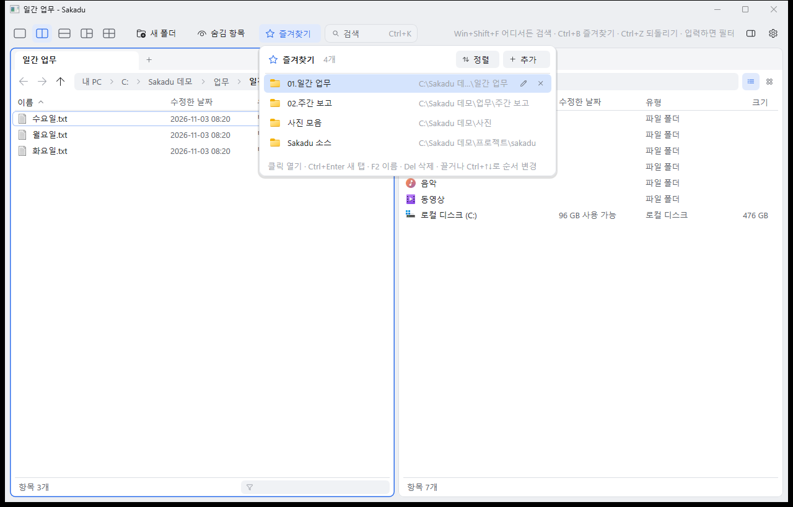

# Sakadu

**사카두**. 시선이 한 곳에서 다른 곳으로 빠르게 옮겨 가는 안구 운동, 사카드(saccade)에서 따온 이름이다.

가볍고 빠른 Windows 멀티뷰 파일 관리자. Q-Dir 같은 분할 화면에 Everything 같은 즉시 검색을 더하고,
우클릭 메뉴·복사 진행 창 같은 탐색기 기능은 그대로 쓴다.

*Sakadu, named after the saccade (a quick eye movement), is a fast, lightweight multi-pane file manager for Windows with instant whole-disk search. Native Rust + Win32 + Direct2D.*


## 특징

- **멀티뷰**: 1·2·3·4분할 레이아웃, 패널마다 탭. 분할선은 끌어서 조절
- **즉시 검색 (Ctrl+K)**: NTFS 디스크 전체를 파일 이름으로 검색. 개발 PC 기준 약 180만 개 항목에서 10~15ms.
  다른 앱 위에서도 전역 단축키로 바로 연다
- **입력하면 바로 필터**: 현재 폴더에서 글자를 치는 즉시 걸러 보기 (한글 입력 지원)
- **썸네일 보기와 미리 보기 창**: 사진·PDF·Office·텍스트를 옆에서 바로 확인
- **즐겨찾기**: 실제 폴더 이름과 별개인 표시 이름("01.일간 업무")과 내 마음대로 정하는 순서
- **탐색기 그대로**: 셸 우클릭 메뉴, 복사·이동 진행 창과 충돌 처리, 끌어서 놓기(기본 복사, Shift 이동), Ctrl+Z 되돌리기
- **가볍게**: 런타임·웹뷰 없는 네이티브 앱. 실행 파일 약 0.7MB
- 다크 모드(시스템 설정 연동), 창·탭 복원, 기본 파일 관리자로 사용(선택)


## 설치

1. [Releases](../../releases)에서 `Sakadu-버전-windows-x64.zip`을 받아 원하는 폴더에 푼다
2. `sakadu.exe`를 실행한다

- 아직 코드 서명이 없어서 처음 실행할 때 "Windows의 PC 보호" 창이 뜰 수 있다. **추가 정보 → 실행**을 누르면 된다
- 설정·세션·즐겨찾기는 `%APPDATA%\Sakadu`에 저장된다
- Windows 11에서 개발·테스트했다. Windows 10(64비트)에서도 돌도록 만들었지만 아직 확인하지 못했다

### 선택 기능

- **디스크 검색 서비스**: Ctrl+K 팔레트의 "검색 서비스 설치" 또는 설정(톱니) 메뉴에서 설치. 관리자 승인(UAC)이 한 번 필요하다
- **기본 파일 관리자**: 설정 메뉴의 "기본 파일 관리자로 사용"을 켜면 폴더·드라이브 열기와 Win+E가 Sakadu로 열린다

### 제거

1. 설정 메뉴에서 "기본 파일 관리자로 사용"을 끄고 "디스크 검색 서비스 제거"를 누른다
2. 압축을 푼 폴더, `%APPDATA%\Sakadu`, (있으면) `%LOCALAPPDATA%\Programs\Sakadu`를 지운다

## 기능 자세히

### 검색 서비스와 개인 정보

- NTFS 고정 디스크의 MFT를 읽어 **파일·폴더 이름만** 메모리에 인덱싱하고, USN 저널로 실시간 갱신한다. 파일 내용은 읽지 않는다
- MFT를 읽으려면 관리자 권한이 필요해서 SYSTEM 서비스(SakaduIndex)로 돌고, 앱은 이름 있는 파이프로 질의한다.
  파이프는 원격 접속을 거부하고, 로그인한 사용자만 쓸 수 있다
- 인덱스는 디스크에 저장하지 않는다. 앱과 서비스 모두 네트워크 코드가 없어 외부로 아무것도 보내지 않는다
- Everything과 마찬가지로, 로그인한 사용자는 다른 계정 폴더의 파일 **이름**도 검색될 수 있다
- 서비스 실행 파일은 `C:\Program Files\Sakadu`에 복사해 등록한다. 앱을 새 버전으로 바꾸면 서비스도 다시 설치해야 갱신된다
- 검색어: 여러 낱말은 모두 포함, `업무\`처럼 `\`를 붙이면 경로로 찾기. Enter 열기 · Ctrl+Enter 위치 열기 · Shift+Enter 새 탭
- 전역 단축키는 Ctrl+Alt+Space → Win+Shift+F → Ctrl+Alt+F 중 비어 있는 첫 키를 쓰고 도구 막대에 표시한다

### 썸네일 보기와 미리 보기 창

- **썸네일 보기**: 경로 표시줄 오른쪽 버튼 또는 Ctrl+Shift+2(자세히 보기는 Ctrl+Shift+6). 패널마다 따로 저장된다.
  화면에 보이는 칸만 백그라운드에서 만들고, 스크롤로 지나간 요청은 버린다
- **미리 보기 창** (Alt+P, 도구 막대 오른쪽 버튼): 활성 패널에서 선택한 항목을 보여 준다
  - 사진: 큰 썸네일 / 텍스트·코드: 앞부분(UTF-8·UTF-16·CP949 자동 판별, 휠로 스크롤)
  - PDF·Office 등: Windows에 등록된 미리 보기 처리기. 처리기가 죽어도 앱은 살아 있도록 별도 프로세스에서만 연다
  - 폴더·그 밖의 파일: 큰 아이콘과 수정한 날짜·위치

### 즐겨찾기



★ 버튼 또는 Ctrl+B. 표시 이름은 실제 폴더 이름과 별개로 정하고(F2), 끌어서 또는 Ctrl+↑↓로 순서를 바꾼다.
이름순·역순·경로순 정렬도 된다. Ctrl+D는 선택한 폴더(없으면 현재 폴더)를 추가하고 바로 이름을 정하게 한다.

### 기본 파일 관리자

설정 메뉴에서 켜면 폴더·드라이브 열기와 Win+E가 Sakadu로 열린다.

- 현재 사용자(HKCU)만 바꾸고, 원래 값을 백업해 두었다가 끌 때 되돌린다
- Win+E는 실행 중인 탐색기가 이전 설정을 기억하고 있어서, 다시 로그인하거나 PC를 다시 시작한 뒤부터 바뀔 수 있다(폴더 열기는 바로 바뀐다)
- 실행 파일은 `%LOCALAPPDATA%\Programs\Sakadu`에 복사해 등록한다. 새 버전으로 바꾸면 한 번 껐다 켜야 갱신된다
- 바탕 화면·작업 표시줄, 제어판·휴지통 같은 특수 폴더, 탐색기 창 안에서의 폴더 이동은 계속 탐색기가 맡는다
- 이미 Sakadu가 떠 있으면 새 탭으로 열린다. 그 창이 응답하지 않으면 폴더가 안 열리는 일이 없도록 탐색기로 대신 연다
- 명령줄: `sakadu.exe --register-default` / `--unregister-default`

### 되돌리기 (Ctrl+Z)

이 앱에서 한 파일 작업을 마지막부터 되돌린다: 이름 바꾸기, 이동(원래 자리로), 복사(복사본은 휴지통으로),
휴지통 삭제(휴지통에서 복원), 새 폴더, 붙여넣기, 끌어서 놓기. 영구 삭제와 셸 우클릭 메뉴로 한 작업은 대상이 아니다.

## 단축키

| 키 | 동작 |
|---|---|
| 글자 입력 | 현재 패널 필터 (Esc로 해제) |
| Enter / Ctrl+Enter | 열기 / 폴더를 새 탭에서 열기 |
| Backspace, Alt+↑ | 상위 폴더 |
| Alt+← / Alt+→, 마우스 뒤로·앞으로 버튼 | 뒤로 / 앞으로 |
| Tab / Shift+Tab | 패널 전환 |
| Ctrl+T / Ctrl+W / Ctrl+Tab | 새 탭 / 탭 닫기 / 탭 전환 |
| Ctrl+1 ~ Ctrl+5 | 레이아웃 |
| Ctrl+Shift+2 / Ctrl+Shift+6 | 썸네일 보기 / 자세히 보기 |
| Alt+P | 미리 보기 창 |
| F2 / F5 / F4, Ctrl+L, Alt+D | 이름 바꾸기 / 새로 고침 / 경로 입력 |
| Ctrl+C / Ctrl+X / Ctrl+V | 복사 / 잘라내기 / 붙여넣기 |
| Delete / Shift+Delete | 휴지통 / 영구 삭제(확인) |
| Ctrl+Shift+N | 새 폴더 |
| Ctrl+H | 숨김 항목 표시 |
| Ctrl+K | 디스크 전체 검색 |
| Ctrl+Z | 마지막 파일 작업 되돌리기 |
| Ctrl+B | 즐겨찾기 (열린 동안 ↑↓·Enter·F2·Del·Ctrl+↑↓, 글자로 항목 찾기) |
| Ctrl+D | 즐겨찾기에 추가 |
| Alt+Enter | 속성 |
| 메뉴 키, Shift+F10 | 우클릭 메뉴 |

## 문제 신고·제안

[Issues](../../issues)에 남겨 주세요. 재현이 어려운 문제는 `sakadu.exe --log`(또는 환경 변수 `SAKADU_LOG=1`)로
실행하면 `%TEMP%\sakadu.log`에 기록이 남는다. 로그에는 폴더 경로가 들어 있으니 올리기 전에 확인하세요.

관리자 권한으로 실행하면(제목에 "(관리자)" 표시) Windows 보안(UIPI) 때문에 일반 권한 탐색기와의 끌어서 놓기가 막힌다.

## 개발

최신 stable Rust(MSVC 도구 체인, edition 2024)와 Windows SDK가 필요하다.

```
cargo build --release
cargo test
```

- 프로젝트 경로가 매우 길면 링커가 260자 경로 제한에 걸린다(LNK1104). 그럴 때는 빌드 출력만 짧은 경로로 돌린다:
  `$env:CARGO_TARGET_DIR = "$env:TEMP\qp-target"; cargo build --release`
- 셸·서비스와 실제로 붙는 테스트와 성능 측정은 `#[ignore]`로 빠져 있다: `cargo test --release -- --ignored --nocapture`
- 테마 강제: `SAKADU_THEME=dark` 또는 `light`
- 릴리스: `Cargo.toml`의 `version`을 올리고 `v0.2.0` 같은 태그를 푸시하면 GitHub Actions가 빌드해 **초안** 릴리스를 만든다. 확인한 뒤 게시한다

### 구조

| 파일 | 역할 |
|---|---|
| `main.rs` | 창 생성, 메시지 루프, 재진입 처리, 명령줄, 한 창만 실행 |
| `app.rs` | 레이아웃, 입력, 그리기, 패널·탭 동작, 설정 메뉴 |
| `app/fav_ui.rs` · `app/palette.rs` · `app/preview.rs` | 즐겨찾기 팝업 · Ctrl+K 검색 팔레트 · 미리 보기 창 |
| `pane.rs` | 탭 상태(기록·정렬·필터·선택) |
| `listing.rs` | 폴더 열거, 내 PC, 표시 포맷 |
| `shell.rs` | 셸 메뉴, 파일 작업, 클립보드, 드래그, 변경 알림, 아이콘 |
| `droptarget.rs` | 드롭 대상(셸 드롭 대상에 위임) |
| `thumbs.rs` | 썸네일 백그라운드 생성 |
| `index.rs` · `service.rs` | NTFS 이름 인덱스(MFT 열거·USN 갱신·검색 순위) · 검색 서비스·파이프·설치 |
| `defaultfm.rs` | 기본 파일 관리자 등록·해제(HKCU, 백업·복원) |
| `undo.rs` | 되돌리기 기록(셸 진행 알림) |
| `favorites.rs`, `session.rs` | 즐겨찾기·세션 저장 |
| `gfx.rs`, `theme.rs`, `util.rs`, `diag.rs` | 렌더링, 색, 경로, 진단 로그 |

기여는 환영한다. 큰 변경은 먼저 이슈로 이야기해 주세요. PR은 `cargo test`가 통과해야 한다.

## 라이선스

[GPL-3.0-or-later](LICENSE). 고쳐서 배포할 때는 같은 라이선스로 소스를 함께 공개해야 한다.
