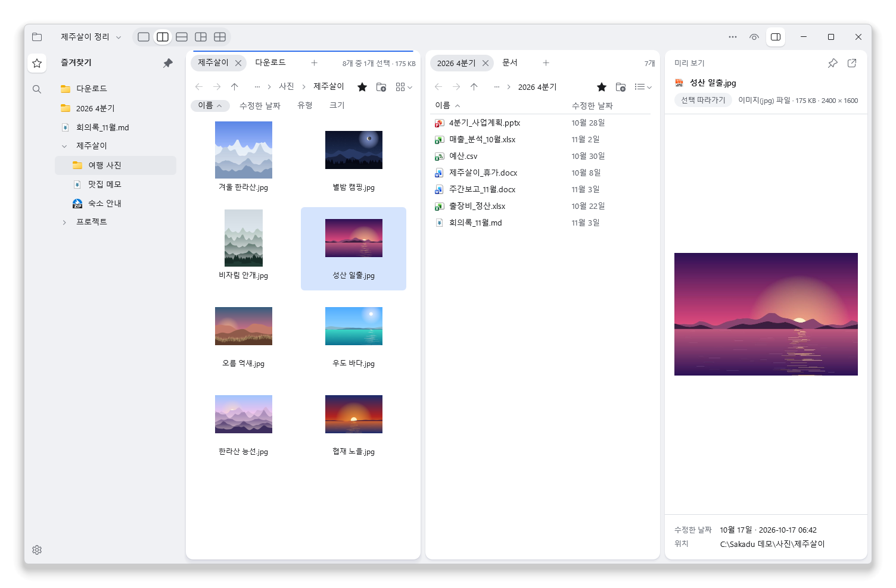
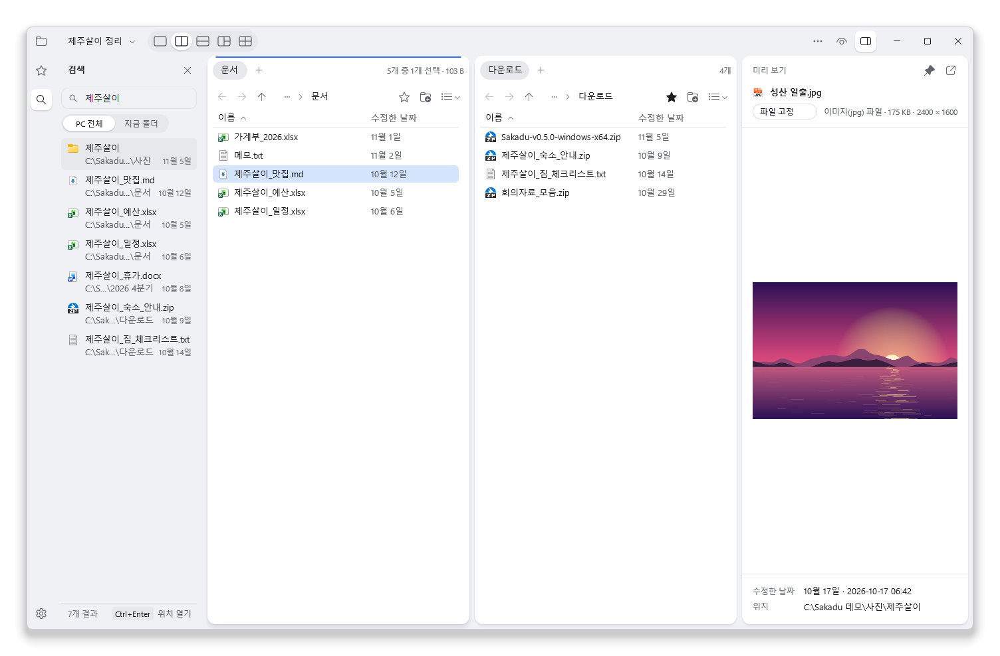
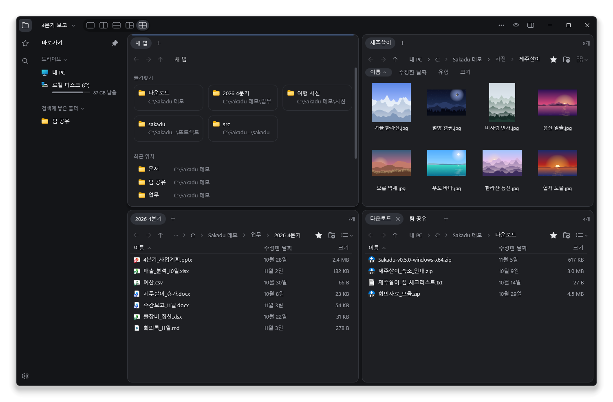

**한국어** | [English](README.en.md)

# Sakadu

폴더 여러 개를 한 창에 띄워 놓고, 디스크 어디에 있는 파일이든 이름만 치면 바로 찾는 Windows 파일 관리자.



**[최신 버전 받기](https://github.com/noddish/sakadu/releases/latest)** · Windows 11 · 설치 없이 exe 하나 · 무료 오픈소스

## 기능

- **바로 찾기**: Ctrl+F를 누르고 몇 글자만 치면 디스크 전체에서 바로 나와요(180만 개에서 10~20ms). 결과는 왼쪽 패널에 남고 날짜·크기가 보여요. 공유폴더·USB도 넣어 두면 함께 찾아요.
- **한 창에 여러 폴더**: 화면을 2·3·4칸으로 나누고 칸마다 탭을 열어요. 탭은 끌어서 다른 칸으로 옮겨요.
- **Ctrl+K 명령 메뉴**: 열린 탭·즐겨찾기·최근 위치로 가고, 명령을 이름이나 초성으로 찾아 실행해요.
- **탐색기와 같은 동작**: 우클릭 메뉴, 복사 진행 창, 끌어서 놓기가 탐색기와 같아요. 잘못 옮기면 알림의 **되돌리기**나 Ctrl+Z.
- **열지 않고 확인**: 썸네일과 미리 보기 창으로 사진·PDF·텍스트를 봐요. 참고할 파일은 미리 보기에 고정해 둬요.
- **작업 공간**: 칸·탭·검색어·미리 보기를 이름 붙여 두고 바꿔 가며 써요. 새 탭에는 즐겨찾기와 최근 위치가 바로 보여요.
- **NAS**: 로그인이 필요한 공유는 Windows 로그인 창으로 열고, 연결이 끊기면 마지막으로 본 목록을 보여 줘요.
- **가벼움**: 런타임·웹뷰 없이 Rust와 Direct2D로 직접 그려요. 다크 모드는 Windows 설정을 따라가요.





## 시작하기

1. [Releases](https://github.com/noddish/sakadu/releases/latest)에서 `Sakadu-버전-windows-x64.zip`을 받아 풀어요.
2. `sakadu.exe`를 실행해요. "Windows의 PC 보호" 창이 뜨면 **추가 정보 → 실행**(아직 코드 서명이 없어요).
3. 디스크 전체 검색은 검색 패널(Ctrl+F)에서 **검색 서비스 설치**를 한 번 누르면 켜져요(관리자 승인 한 번).

설정(톱니)에서 기본 파일 관리자로 쓰기, 트레이에서 대기(창을 닫아도 단축키로 검색), 테마·단축키를 바꿔요. 사용법은 F1.

## 자주 쓰는 키

| 키 | 하는 일 |
|---|---|
| Ctrl+F | 디스크 전체 검색 |
| Ctrl+K | 명령 메뉴 |
| 글자 입력 | 지금 폴더에서 바로 걸러 보기 (Esc로 해제) |
| Ctrl+1 ~ Ctrl+5 | 화면 나누기 |
| Tab / Shift+Tab | 다음 칸 / 이전 칸 |
| Ctrl+T / Ctrl+W | 새 탭 / 탭 닫기 |
| Alt+P | 미리 보기 창 |
| Ctrl+B / Ctrl+D | 즐겨찾기로 이동 / 추가 |
| Ctrl+Z | 방금 한 파일 작업 되돌리기 |

나머지 단축키는 설정 → **단축키**에서 보고 바꿔요.

## 알아 두면 좋은 것

<details>
<summary>검색 서비스와 개인 정보</summary>

- NTFS 디스크의 파일 목록에서 **파일·폴더 이름만** 읽어 메모리에 둬요(180만 개에 120MB쯤). 파일 내용은 읽지 않고, 인덱스를 디스크에 저장하지도 않아요.
- 네트워크 코드가 없어서 밖으로 나가는 것이 없어요. 앱과 서비스(SakaduIndex)는 이 PC 안의 파이프로만 주고받아요.
- 검색한 Windows 계정이 탐색기로 열어 볼 수 있는 것만 결과에 나와요. 확인 절차: [docs/search-permissions-check.md](docs/search-permissions-check.md)
- 검색어: 띄어 쓰면 모두 포함, 끝에 `\`를 붙이면 경로로, `|`로 나누면 그중 하나(`견적 2026 | 계약서`).
- 서비스는 `C:\Program Files\Sakadu`에 복사해 등록해요. 앱을 새 버전으로 바꿔도 서비스는 다시 설치할 때만 갱신돼요.

</details>

<details>
<summary>기본 파일 관리자, 트레이 대기</summary>

- 설정 → 일반에서 켜요. 현재 사용자 설정(HKCU)만 바꾸고, 끄면 원래대로 되돌려요.
- 실행 파일은 `%LOCALAPPDATA%\Programs\Sakadu`에 복사해 등록해요. 새로 받은 `sakadu.exe`를 실행하면 떠 있던 창을 이어받고 이 사본도 바꿔요.
- 트레이에 숨은 Sakadu를 완전히 끝내려면 트레이 아이콘을 오른쪽 클릭하고 **끝내기**.

</details>

<details>
<summary>지우는 방법</summary>

1. 설정에서 **기본 파일 관리자로 사용**·**트레이에서 대기**를 끄고, 검색 서비스를 **제거**해요.
2. 압축을 푼 폴더와 `%APPDATA%\Sakadu`(설정·즐겨찾기), `%LOCALAPPDATA%\Programs\Sakadu`(있으면)를 지워요.

</details>

## 문제가 생기면

[Issues](https://github.com/noddish/sakadu/issues)에 남겨 주세요. `sakadu.exe --log`로 실행한 뒤 `%TEMP%\sakadu.log`를 함께 올려 주시면 큰 도움이 돼요(폴더 경로가 들어 있으니 확인 후 올려 주세요).

## 직접 빌드하기

stable Rust(MSVC, edition 2024)와 Windows SDK가 있으면 돼요.

```
cargo build --release
cargo test
```

<details>
<summary>개발 메모</summary>

- 경로가 길어 링커가 LNK1104로 실패하면 빌드 출력만 짧은 경로로: `$env:CARGO_TARGET_DIR = "$env:TEMP\sakadu-target"`
- 셸·서비스와 붙는 테스트와 성능 측정: `cargo test --release -- --ignored --nocapture`
- 시험용 환경 변수: `SAKADU_THEME=dark|light`, `SAKADU_TRAY=0|1`, `SAKADU_ISOLATED=1`(쓰고 있는 Sakadu와 따로 뜨는 시험 창. `APPDATA`·`LOCALAPPDATA`도 다른 폴더로 돌려 두세요)
- 릴리스: `Cargo.toml`의 `version`을 올리고 `v0.7.0` 같은 태그를 푸시하면 GitHub Actions가 초안 릴리스를 만들어요.
- 코드: `app.rs`(레이아웃·입력·그리기)와 `app/`(패널·검색·미리 보기·명령 메뉴·시작 화면·설정), `index.rs`·`service.rs`(검색 인덱스·서비스), `shell.rs`(셸 메뉴·파일 작업), `listing.rs`(폴더 읽기)

기여는 환영해요. 큰 변경은 이슈로 먼저 이야기해 주세요.

</details>

## 이름과 라이선스

사카두(Sakadu)는 눈이 한 곳에서 다른 곳으로 휙 옮겨 가는 움직임, 사카드(saccade)에서 따왔어요. [GPL-3.0-or-later](LICENSE).
